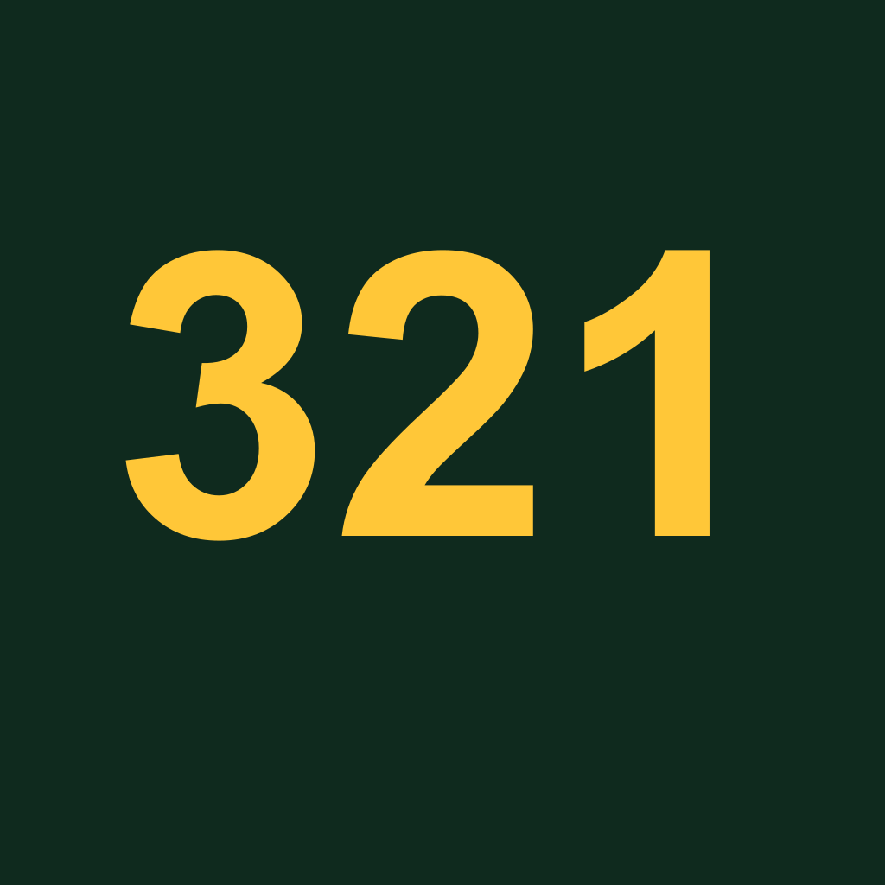
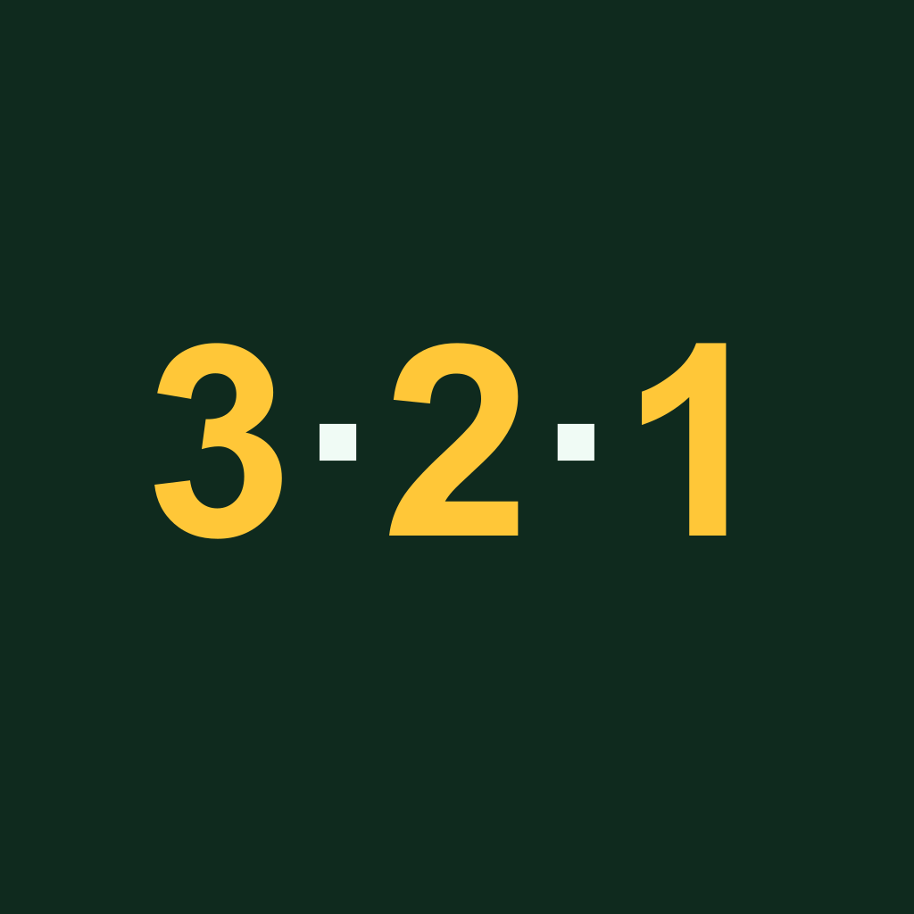
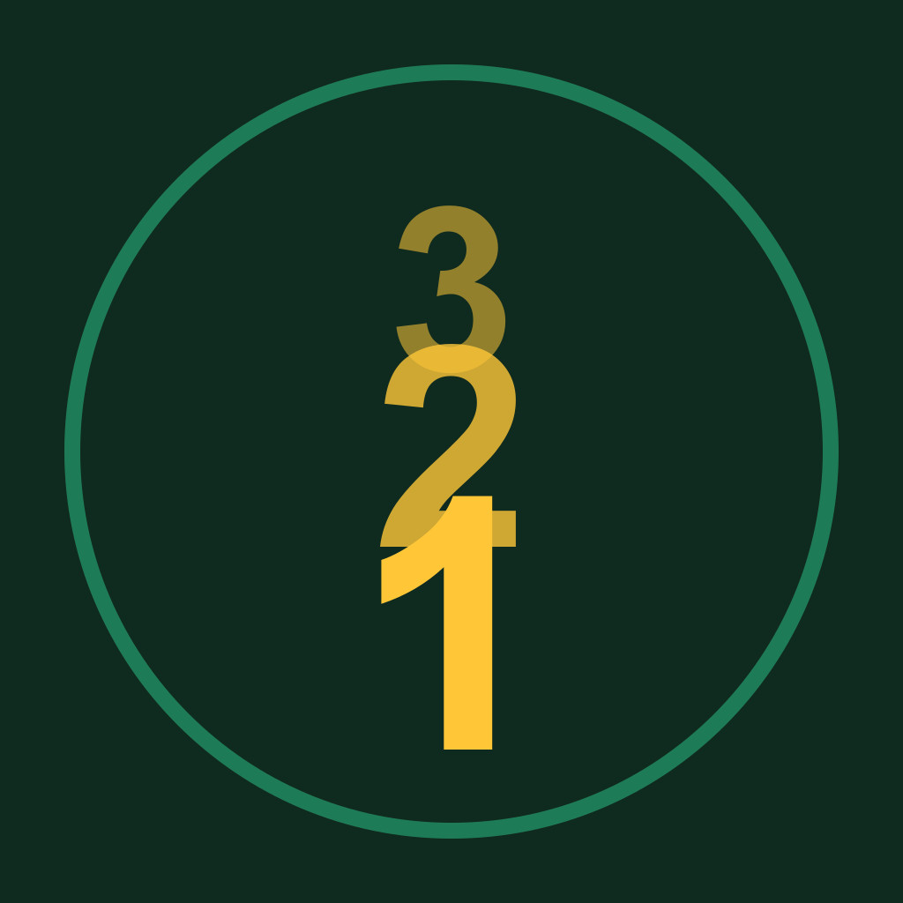
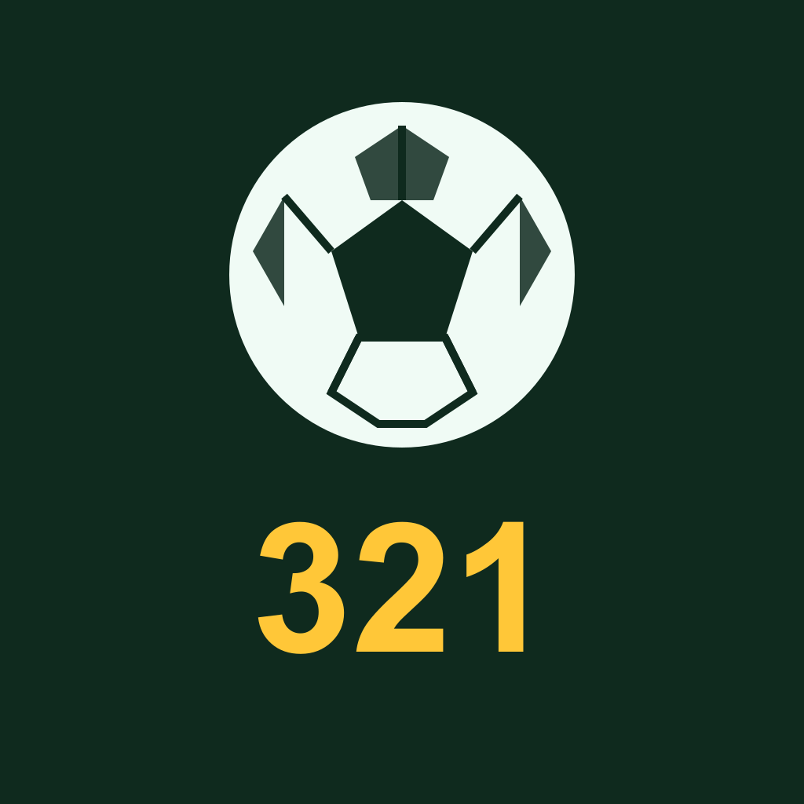
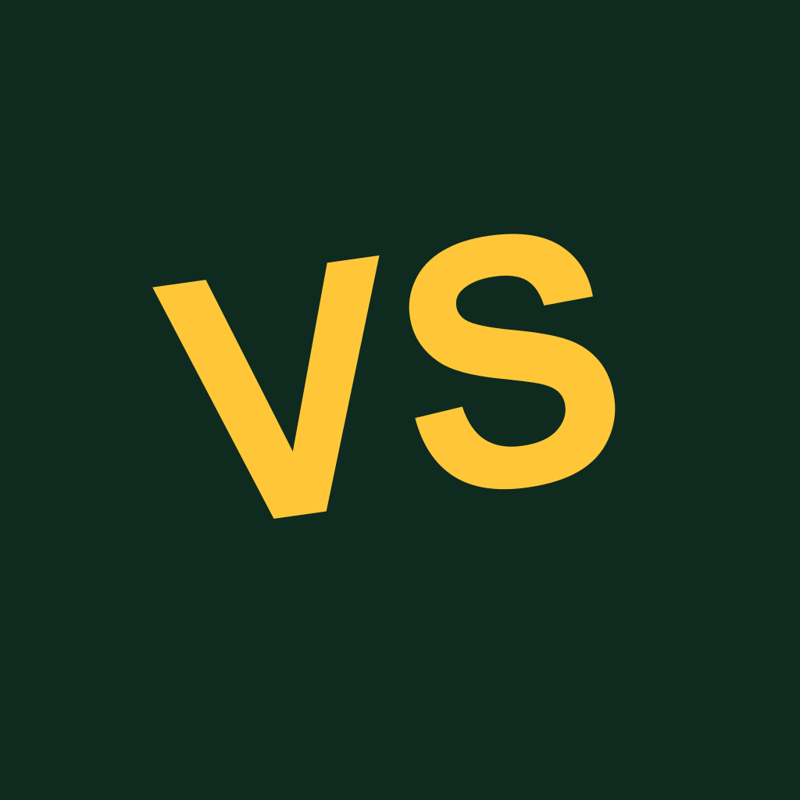
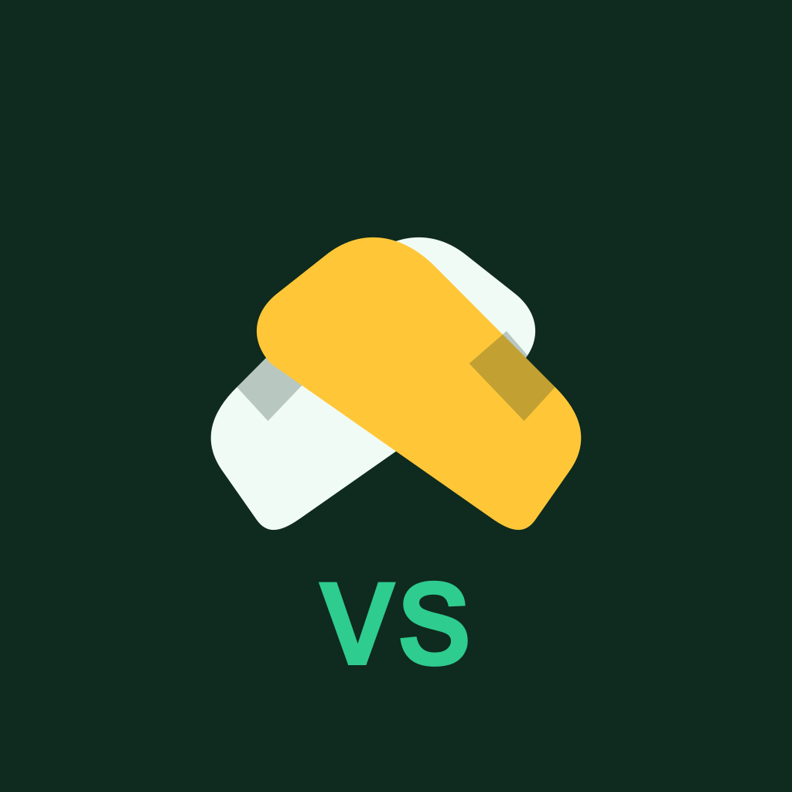

# 321guess — App Icon Design

## Problem

The app's icon/splash branding was never customized — it's still Expo's default template end to end:

- `apps/web/assets/images/icon.png` — Expo's default blue chevron symbol
- `apps/web/assets/expo.icon/` — Expo's default Icon Composer bundle (`icon.json` fill is Apple system blue `extended-srgb:0.00000,0.47843,1.00000,1.00000`, shape is `expo-symbol 2.svg`)
- `apps/web/assets/images/android-icon-foreground.png` / `-background.png` / `-monochrome.png` — same default blue chevron
- `apps/web/assets/images/splash-icon.png` + `expo-splash-screen` plugin config (`app.json`) — background color `#208AEF`, Expo's default blue
- `expo-notifications` plugin icon color — also `#208AEF`
- `apps/web/src/components/animated-icon.tsx` — native splash overlay genuinely renders `expo-logo.png` (Expo's own template logo) as the launch animation
- `apps/web/public/favicon*.png`, `og-image.png` etc. — currently generated FROM the wrong `icon.png`, so they inherit the same problem

This blocks App Store / Play Store submission — the already-completed EAS production builds from earlier this session used the Expo default icon and are obsolete until this is fixed.

## Brand palette (established, "arena" design system)

| Token | Hex | Use |
|---|---|---|
| `arena-bg` | `#0F2A1E` | base background |
| `arena-bg-soft` | `#153A28` | card/surface |
| `arena-accent` (amber) | `#FFC738` | primary accent |
| `arena-accent-strong` | `#C99418` | accent pressed/border |
| `arena-accent-2` (mint) | `#2ECC8F` | secondary accent |
| `arena-text` (cream) | `#F0FBF5` | primary text/light shapes |
| `arena-text-soft` | `#8FE8C4` | secondary text |

## Constraint: category-agnostic

321guess is currently a football-player-guessing game, but there are concrete plans to expand into other categories later (NBA player guessing, TV/movie actor guessing). This means:

- Football-specific imagery (a ball, boots/cleats) commits the brand to football and would need to be redesigned when a new category ships.
- Imagery tied to the app's actual mechanic — the name ("321"), the countdown, or the "versus/challenge" idea of the guessing format — stays correct regardless of category.

Every concept below is tagged **category-agnostic** or **football-specific** on that basis.

## Concepts

All rendered at 1024×1024 on `arena-bg` (#0F2A1E). Files are in this folder (`concept-a.png` … `concept-g.png`).

### A — Plain "321"

Bold amber "321" numerals, single line, huge and simple. **Category-agnostic** — literal app-name mark, no domain imagery at all.

### B — "3·2·1" with dots

Same numerals with cream separator dots, matching the site's wordmark style (`3·2·1guess`). **Category-agnostic.**

### C — Countdown stack + ring

3/2/1 shrinking downward inside a mint ring, evoking the in-app countdown animation directly. **Category-agnostic.**

### D — Soccer ball + "321"

Simplified soccer ball with amber "321" beneath. **Football-specific** — would need replacing if/when NBA or movie categories ship.

### E — "VS", bold and tilted

Large tilted amber "VS" wordmark, sports-poster style. **Category-agnostic** — "versus" describes the guessing format itself, not a sport.

### F — Crossed boots + "VS"

Two crossed football boots/cleats (cream + amber) with mint "VS" beneath. **Football-specific.**

### G — Crossed swords

Two crossed swords (cream + amber), literal "challenge/duel" imagery, no text. **Category-agnostic** — reads as "head-to-head" without naming a sport.

## Recommendation

Given the multi-category roadmap, prefer a **category-agnostic** concept: **E ("VS")** or **G (crossed swords)** carry the "challenge/versus" idea without naming a sport; **A/B ("321")** tie directly to the app name instead. D and F are strong *football* icons but are the wrong bet if the NBA/movie expansion is real.

## Decision

_Not yet chosen — fill in once decided:_

- **Chosen concept:** —
- **Any requested tweaks:** —

## Implementation checklist (once a concept is chosen)

Regenerate/replace, from the final 1024×1024 master art:

1. `apps/web/assets/images/icon.png` — main icon source (referenced by `app.json` → `expo.icon`)
2. `apps/web/assets/expo.icon/` — rebuild the Icon Composer bundle (`icon.json` fill + `Assets/`) to match, for iOS 18+ (currently Apple-blue default)
3. `apps/web/assets/images/android-icon-foreground.png` / `-background.png` / `-monochrome.png` — Android adaptive icon set (`app.json` → `android.adaptiveIcon`, currently background `#E6F4FE`)
4. `apps/web/assets/images/splash-icon.png` + `app.json` → `expo-splash-screen.backgroundColor` (currently `#208AEF`, Expo default blue) — switch to `arena-bg` or another brand color
5. `app.json` → `expo-notifications.color` (currently `#208AEF`) — switch to brand accent
6. `apps/web/src/components/animated-icon.tsx` — native splash overlay currently renders `expo-logo.png`; swap for real branding
7. `apps/web/public/favicon-16x16.png`, `favicon-32x32.png`, `apple-touch-icon.png`, `android-chrome-192x192.png`, `android-chrome-512x512.png`, `favicon.ico`, `og-image.png` — regenerate from the new master (script pattern: `sharp`-based resize, see prior `gen-assets.js`)
8. `apps/web/assets/images/favicon.png` — separate web favicon referenced directly by `app.json` → `web.favicon`
9. Trigger fresh EAS production builds for iOS and Android — the icon is baked into the native binary, so any earlier "finished" build is obsolete until this ships
